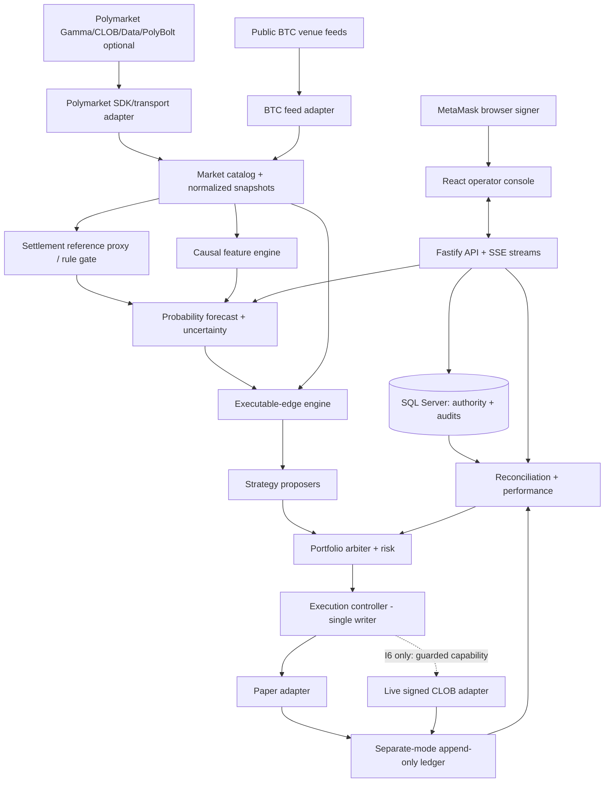

# Architecture.md — Polymarket BTC 5-Minute Trading System

> **Status:** Greenfield design baseline, proposed for implementation (not a claim of profitability or exchange eligibility)  
> **Version / reviewed:** 1.0 · 2026-10-16  
> **Scope:** A single operator, one authorized Polymarket account, BTC **five-minute Up/Down** markets only.  
> **Delivery:** Six vertical iterations; end-to-end browser experience from Iteration 1.  
> **Runtime default:** `OBSERVE`; **all live exchange order writes are absent/disabled until Iteration 6 passes its release gate**.  
> **Source of truth:** This document for architecture, [UX.md](UX.md) for product experience, and `Iteration-{1..6}-Implementation-Plan.md` for delivery.

---

## 1. Purpose, objective, and non-goals

Build a locally operated, browser-managed **autonomous BTC 5m Polymarket trading system** intended to discover repeatable **positive net expected value** and measure realized returns after fees, execution and operational costs. No model or strategy is assumed profitable. The bot can choose **NO TRADE** for an entire market. It must not equate high classification accuracy with positive trading PnL.

Six capabilities: (1) account-connected live dashboard, (2) probabilistic fair-value forecasts, (3) executable opportunity assessment, (4) recoverable order workflow and financial ledger, (5) forward-only live-feed paper trading and performance evaluation, (6) separately authorized restricted autonomous live trading. Later features become real in their iterations, but navigation and honest empty/unavailable states ship in Iteration 1.

**In scope:** normal trading, positions, settlement and optional reduction of exposure on supported Polymarket BTC 5m binary token markets; three strategy families (directional mispricing, completed or sequential paired acquisition, passive inventory-aware quotes) introduced incrementally; rule-aware real-time data, risk, fills and account reconciliation.

**Out of scope v1:** multi-user SaaS, other symbols/intervals, leverage, off-exchange hedging, managed custody of the MetaMask seed phrase, paid Chainlink subscription, automated creation of wallets, cross-market basket arbitrage, production ML pipelines, self-modifying reinforcement learning, guaranteed profits, unsupported geography or exchange restrictions, and historical backtest prerequisites. Forward live observation is the default evaluation method.

### 1.1 Invariants

1. **One exchange writer:** strategies and GUI produce intents only. An account-level portfolio/risk controller is the sole authority approving a trade; the execution controller alone can submit/cancel.
2. **Modes are separate capabilities:** `OBSERVE`, `PAPER`, `LIVE`. A paper adapter cannot call exchange order endpoints; the live adapter is not wired in I1–I5. Different accounting books and visible mode labels.
3. **No silent source substitution:** Binance BTCUSDT, Coinbase BTCUSD, Polymarket prices, and Chainlink-related settlement prices are different observables. A public proxy is never labeled the authoritative settlement value.
4. **Fail closed:** unknown wallet mapping, settlement semantics, credentials, authorization, stale/invalid books, uncertain order outcome, unreconciled balance or unsupported trading location blocks new live risk. Health cannot be inferred solely from HTTP 200.
5. **No exposed secrets:** wallet seed/private key never entered in the GUI; existing CLOB L2 environment variables are server-side only. No browser bundle, telemetry, SQL, screenshot, exported reports or Git history may contain secrets.
6. **Order intent first:** record and commit an authorized unique intent and associated reservation before any live send. On network uncertainty, reconcile; never blindly replay a non-idempotent order.
7. **Correct economics:** model all executable depth levels, market fee schedule/rounding, quantity restrictions, pending/reserved capital, correlation, open/partly hedged inventories and actual settlement payouts.
8. **Honest performance:** paper PnL always labeled simulated; displayed realized PnL includes recognized fees/settlement; unresolved positions and stale marks are shown separately. Never imply paper fills are real.
9. **No forced live enable:** I6 is conditional on current operator/account/geographic eligibility and confirmed supported autonomous signer, and requires explicit separate approval.
10. **Minimal critical tests, not zero tests:** high-risk authentication, risk bypass, fee math, order recovery, partial fills, accounting, settlement and mode-isolation tests are release blockers.

## 2. Architectural decisions

| Decision | Choice | Rationale / constraints |
|---|---|---|
| Architecture | Single-instance event-driven **modular monolith** | One account, modest scale, simpler atomic risk and ledger decisions. |
| Main backend | **Node.js LTS + TypeScript (strict) + Fastify** | Direct use of official `@polymarket/client`; avoid custom order signing and a separate language bridge. |
| Frontend | React + strict TypeScript, Vite, Tailwind, TanStack Query | Responsive, strongly typed browser shell from I1; Web3 via viem/wagmi or a compatible maintained library. |
| Exchange integration | `@polymarket/client` pinned, behind typed adapters | Official SDK for public/secure flows. Revalidate SDK/endpoint compatibility before I6. |
| Database | Local **Microsoft SQL Server**, Windows Integrated Authentication where supported by the chosen Node driver | Preserves preferred local DB; implement an early connectivity proof. Use decimal SQL types, migrations, unique constraints and transactions. Avoid shipping a password in config. |
| High-volume telemetry | Bounded short-retention compressed files (Parquet optional), SQL for authoritative state | Forward evaluation needs reproducible recent decisions, not unlimited full historical archiving. |
| Real-time UI | **Server-Sent Events**, two same-origin streams (public and owner session). WebSocket is not used. [ADR 0005](docs/adr/0005-server-sent-events-transport.md) | Server reconciles feeds and coalesces browser updates; avoid direct browser exchange-credential use. |
| Background jobs | In-process supervised workers, bounded queues, monotonic timeouts | No Kafka, Redis, cloud, Kubernetes or GPU required. |
| Modeling | Causal analytical stochastic model, optional simple calibrated logistic correction | Transparent and efficient; do not train large neural nets first. |
| Deployment | Local Windows PC. Fastify terminates HTTPS on **`https://127.0.0.1:8443` only**. [ADR 0004](docs/adr/0004-loopback-https-single-origin.md) | Single operator and one browser origin. `localhost` is a different origin and is not the desk URL. Non-loopback exposure requires a new ADR and security review. |
| Autonomous signing | **Pluggable, initially unavailable**; investigate eligible scoped session key vs dedicated restricted signer | CLOB L2 keys alone are not order-signing keys. Never export MetaMask private key. |
| Financial arithmetic | Exact fixed-point/decimal (SQL `DECIMAL`, TypeScript decimal library or bigint-scaled amounts) | No JS floating point for cash, fee, share or ledger totals. Floating point acceptable for statistical inference only. |

**I1 decision record:** [docs/adr/](docs/adr/) accepts the single Fastify process, React/Vite shell, pnpm workspace, SQL Server Windows-identity intent, loopback origin, SSE transport, public-read matrix, and OBSERVE-only composition. Those records do not authorize order signing, exchange writes, paper execution, forecasts, or non-loopback hosting. SDK and driver behavior are proof obligations, not facts already demonstrated.

**Development-only helper:** A separate loopback Vite process may serve frontend assets behind Fastify in dev mode. It is not a second application backend or browser origin. Fastify retains API, health, and SSE handling and strips credential-bearing request headers and upstream `Set-Cookie` headers at the development proxy boundary ([ADR 0001](docs/adr/0001-single-fastify-process.md), [ADR 0004](docs/adr/0004-loopback-https-single-origin.md)). Start mode serves built assets in the single Fastify process.

**SDK/OS proof in I1:** verify runtime SDK can read existing L2 credentials *without* requiring a live private signer; if its secure client requires signing, use supported read-only L2 HMAC adapter or an explicit typed direct API wrapper just for private reads. Do **not** create dummy private keys. Choose the Node SQL driver only after a Windows-integrated smoke test under the intended process identity; otherwise present a documented alternate credential mechanism without logging it ([ADR 0003](docs/adr/0003-sql-server-windows-identity.md), [ADR 0007](docs/adr/0007-i1-observe-boundaries-and-sdk-proof.md)). The CLI and host must fail clearly rather than silently fallback to a different DB.

### 2.1 Official compatibility facts to recheck at implementation time

- CLOB **L1** is signer/EIP-712 authorization for credential bootstrap; **L2** uses API key/secret/passphrase and HMAC for private requests. Placing an order additionally requires a signed order from an authorized signer. [API authentication](https://docs.polymarket.com/getting-started/api), [wallets](https://docs.polymarket.com/trading/wallets-auth).
- Current unified JS SDK is `@polymarket/client`, with public/secure clients and CLOB V2 support. Pin and test a specific version rather than relying on `latest`. [Unified SDK guide](https://docs.polymarket.com/migrate/clob-sdk-to-unified-sdk), [CLOB V2 migration](https://docs.polymarket.com/v2-migration).
- Session Keys are **beta**, scoped and time-limited, available only for supported Deposit Wallet flows and subject to Builder authorization. They are **not** assumed compatible with a pre-existing MetaMask/Safe/Proxy account. Verify first. [Session Keys](https://docs.polymarket.com/trading/session-keys).
- Current crypto taker fee documentation states `fee = C × rate × p × (1-p)` per fill and maker fee zero; read the actual market fee schedule and rounding/precision at runtime. Rebate income is **never** assumed before confirmed. [Fees](https://docs.polymarket.com/trading/fees).
- Chainlink TWAP Up/Down compares a reference TWAP at start and end, where equality resolves Up under published guide; the actual five-minute market's rule text and reference selector must be verified per current market. [Resolution guide](https://docs.polymarket.com/concepts/resolution).
- Geographic restrictions must be evaluated from the **trading host's actual egress location** using current official restrictions; if restricted or unknown, no live order writes. Do not employ a proxy/VPN as a bypass. [Geographic restrictions](https://docs.polymarket.com/api-reference/geoblock).
- Exchange and SDK behavior may change; I6 demands refreshed official documentation and real account/signer proof, not historical assumptions.

## 3. System context, boundaries, and event flow



The GUI is an operator surface, **not** the trading process. Closing the browser does not stop an already authorized backend-run paper or live session. Closing the browser never secretly starts one. The backend service is single-instance for account execution; if a second instance tries to become live writer, a database lease/fencing mechanism prevents dual ownership.

### 3.1 Bounded contexts and ownership

- **Identity & Connectivity:** browser sign-in challenge, authenticated session, L2 credential read, account identity and eligibility/status. No signing service in the frontend.
- **Market Catalog & Data:** discover current/next market, exact market IDs, pair tokens, rule text, contract times, CLOB market snapshot, optional trades, BTC feeds, age/gap/health status.
- **Reference & Forecasting:** rule-scoped opening/reference state, external proxy estimator, causal feature sets, fair probability, calibration and uncertainty.
- **Opportunities:** simulate marginal execution quantities against book levels, fees, fills and required buffer, strategy-specific proposals with reasons.
- **Portfolio & Risk:** shared available capital, positions, reserved/in-flight orders, max liabilities, loss halt, signing and data gates, versioned approvals.
- **Execution:** durable order state machine, unique intents, paper/live adapters, official status, partial fills/cancel races, liveness and reconciliation.
- **Accounting & Reporting:** append-only accounting events, per-mode portfolios, fee/settlement/realized/unrealized equity, explainable statistics.
- **Operations & UX:** GUI, system diagnostics, audit, configuration, notification, start/pause/halt workflows and permissions.

All cross-context messages have `eventId`, `marketId`, `accountId`, `mode`, `sourceTimeUtc?`, `receivedAtUtc`, `processedAtUtc`, `schemaVersion` and monotonic local ordering key. Treat timestamp **origin** explicitly; never assume Binance, CLOB and oracle clocks coincide.

## 4. Account auth, custody and permission architecture

### 4.1 Three distinct credentials/identities

1. **Browser user authentication (MetaMask):** login challenges bind domain/origin, nonce, issued/expiry times, chain/network, intended login action and server session. Verify ownership and one-time replay prevention server-side. No login simply because a wallet appears connected. Use secure HTTP-only session cookie, CSRF protection and owner allowlist (single operator).
2. **CLOB L2 credentials:** read only from process environment: `POLYMARKET_API_KEY`, `POLYMARKET_API_PASSPHRASE`, `POLYMARKET_API_SECRET`. Validate presence without exposing values. The server signs supported private requests with HMAC. CLOB credentials do not prove association with an arbitrary MetaMask or funds wallet: identify signer, funder/account wallet type and test ownership through supported exchange/account evidence. If ambiguous, `ACCOUNT_UNVERIFIED` and hide balances as unknown.
3. **Order signer (I6 only):** backend-use permission explicitly bound to the verified account; prefer official restricted session signer *only if currently supported for this wallet* and approved. Otherwise evaluate a dedicated limited-funds signer compatible with wallet type, explicit operator provisioning and secure local key custody. Never prompt for or store MetaMask seed/private key. If no safe valid unattended signer exists, autonomous live trading is **not implementable for that account** without changing wallet setup.

### 4.2 Credential handling

- Env variables are injected into server process, **never** into Vite `VITE_*`, browser responses, logs, support bundles or model prompts. Show statuses (`Configured`, `Authenticated`, `Unauthorized`, `AccountUnverified`) with sanitized error codes.
- Keep an allowlist of configured addresses, signer/account-wallet mapping, chain ID, protocol capability and current evidence. Account display must identify `Connected wallet`, `Trading account`, `Signing capability` separately.
- For I6 autonomous key, use OS-bound key protection/approved secure storage with least-privileged process identity and a documented revocation path; do not claim DPAPI or TPM alone protects against administrator or malware controlling the host. Key storage requires explicit threat review.
- Signer interface is **capability-scoped**: `Unavailable` / `ReadOnly` / `OrderSigning`. Never register live signing in an I1–I5 run. On startup any signer mismatch disables live execution.
- Operator settings are versioned and backend validated; frontend state alone can never enable live mode.

## 5. Live market data and settlement reference

### 5.1 Discovery

Discover actual BTC five-minute market series through current published metadata; verify full rule publication, identity, outcome token IDs, explicit opening/closing UTC, active/closed status, CLOB active/trading-enabled flags, tick size, minimum size, fee schedule and any exchange-specific requirements. Do **not** derive the whole market identity from a slug or an approximate timestamp. Prefetch upcoming market and retain closing one only for settlement/accounting.

### 5.2 Feeds and integrity

- Public/independent: Binance BTCUSDT trades/quotes and Coinbase BTCUSD trades/quotes; their USD/USDT basis is retained, never averaged without adjustment.
- Polymarket: UP and DOWN CLOB books, best bid/ask, published trades; discover each token and validate its side. Real time snapshots/deltas must obey a validated continuity mechanism; on unproven sequence/stream integrity invalidate book and recover from a validated full snapshot. Exchange protocol lacking a continuity guarantee cannot be upgraded by invented sequence numbers.
- Optional authenticated PolyBolt or other settlement-reference feed: only after real access test and documented stream/contract equivalence. No paid dependency.
- A server-only `MarketSnapshot` reports source timestamp, receive timestamp, monotonic age, continuity epoch, bid/ask levels, tick/size constraint, provider state, `validForTrading` and failure reason.
- Bounded queues; overflow invalidates affected derived state. A healthy heartbeat does **not** make an invalid depth book executable. Retry with jitter/rate limiting; retain gap/quality diagnostics. Never place a new order using a stale or internally contradictory snapshot.

### 5.3 Settlement-reference classification

`VerifiedContractual` requires rule-version match **and** independent evidence for exact source/report selection and boundary behavior. `EstimatedProxy` uses transparent time-aligned BTC market inputs, venue divergence, and time-windowed approximation with tracked uncertainty. `Unavailable` means no forecast suitable for trading. An official published market **outcome** is a label for forecast scoring, not proof the proxy matched the exact oracle readings. Rule changes require new version and manual review. No five-minute average is silently substituted for a stated 60-second TWAP.

## 6. Model: probability of official Up resolution

For the exact market event `U`, compute `PUp = P(U | information received by t)` and `PDown = 1-PUp`. The receipt-time causal information set matters: never use a later observation from the same five-minute window to explain an earlier decision.

### 6.1 Tiers

- **M0 market baseline:** executable midpoint/bid-ask market-implied probability, with limitations from spread, inventory and fees. This is the benchmark, not assumed truth.
- **M1 statistical probability:** scenario or analytical process for likely terminal reference outcomes conditional on current reference proxy, opening reference uncertainty, time remaining, volatility/jumps and venue divergence. Conditional probability estimates are conditional on the *assumed* proxy process, not guaranteed oracle truth.
- **M2 optional microstructure correction:** simple bounded logistic regression or small gradient-boosted model using short-horizon returns, momentum, volume/trade imbalance, depth skew, volatility changes, and cross-exchange basis. Starts disabled until enough forward labels exist; compare on fresh temporal holdout.
- **M3 calibration/uncertainty:** reliability diagrams, Brier/log-loss by time remaining/volatility, conservative lower/upper ranges only when empirically supported, drift/staleness flags. Uncalibrated results show `BoundsUnavailable` rather than invented confidence.

### 6.2 Example input features

`marketId, settlementSpecHash, secondsToClose, openingReferenceValue? + source/bounds, currentProxyValue?, proxyDivergence, lastBTCPriceByVenue, logReturns[1s/5s/15s/30s/60s], realizedVol, jumpFlag, BTCVolumeImbalance, UP/DOWN spread, UP/DOWN bookAge, CLOBDepthImbalance, tokenLiquidity, sourceAges, marketTradingStatus`. Portfolio holdings **do not** enter event probability; they affect strategy and risk.

### 6.3 Forecast object

```ts
export type ReferenceBasis = 'verified-contractual' | 'estimated-proxy' | 'unavailable';
export type Calibration = 'uncalibrated' | 'provisional' | 'validated';
export interface ProbabilityForecast {
  forecastId: string;
  marketId: string;
  modelVersion: string;
  featureSnapshotId: string;
  settlementSpecHash: string;
  referenceBasis: ReferenceBasis;
  pUp: number;               // inference math only, 0..1
  pDown: number;             // 1 - pUp
  conservativeUpLower: number | null;
  conservativeUpUpper: number | null;
  calibration: Calibration;
  generatedAtUtc: string;
  validUntilUtc: string;
  blockers: readonly string[];
}
```

On missing/uncertain critical input, report unavailable or a visibly research-only estimate and suppress trade proposals. Clamp only for floating-point rounding; reject NaN/Infinity, missing inputs and impossible chronology. Model runtime loads a pinned version and immutable feature-schema identifier; activation is reviewed, not self-modifying.

### 6.4 Validation plan

Use weeks of incoming data (no mandatory historical backtest): preserve every pre-decision forecast with timestamps and version; independently observe official final result; score Brier/log-loss, calibration slices, reliability versus M0, and **net simulated economics**. Require untouched forward holdout after selecting a model. Do not claim significant edge based on a handful of markets. Include source-quality/settlement/proxy gaps in reports; if results lack representative data or sample counts, conclusion is **inconclusive**.

## 7. Opportunity engine and strategies

### 7.1 Executable quantities, not quoted profits

Given a validated depth snapshot, compute cumulative quantity, precise weighted average price, price ticks, estimated market-specific fee per actual fill, and residual unmatched risk. Evaluate each feasible quantity **marginally**; avoid sizing to a theoretical ask that has insufficient depth. Partial fills and unavailable liquidity reduce executable opportunity. Model market/taker orders only through supported exchange semantics, never assume guaranteed complete fills.

For ordinary binary settlement, per-share conservative buy-to-resolution economics:

`edgeUp(q) = lowerPUp - averageExecutableUpAsk(q) - modeledTakerFees(q)/q - additionalUncertaintyAndExecutionBuffer(q)`

`edgeDown(q) = (1 - upperPUp) - averageExecutableDownAsk(q) - modeledTakerFees(q)/q - additionalUncertaintyAndExecutionBuffer(q)`.

If validated probability bounds are unavailable, mark opportunity `ResearchOnly` (or apply an explicitly unvalidated scenario discount for simulation; never label it a statistical bound). Separate fee, depth impact, slippage, reference uncertainty, latency and risk reserve to **avoid double counting**. For selling before settlement, model future realizable exit bids: settlement expected value alone is insufficient.

### 7.2 Three proposal strategies

1. **Directional edge:** buy Up/Down only when independent conservative expected payoff beats all-in fill cost, within time, liquidity and risk limits. Exclude unverified settlement reference from real directional trade gating.
2. **Paired acquisition:** immediately attempt a complete Up+Down pair only when executable *combined* cost + fees + bounds is below verified normal complete-pair payout. Since legs cannot be atomic, even "immediate" acquisition has leg/execution risk. Sequential acquisition allows purchasing cheap first leg and waiting for opposite later: this is an **open directional position**, with hedging deadline, max mismatch, stress-loss budget, abandonment/cancel logic and per-lot cost accounting. Rebate not assumed.
3. **Inventory-aware maker:** hypothetical resting quotes informed by fair value, adverse-selection penalty, order/fill latency, expiry and signed inventory. Avoid maker-fill optimism; use queue uncertainty/pessimistic sensitivity. Enable initially only in paper once supported, do not claim returns on unfilled quotes.

Every strategy emits immutable `TradeProposal` (`proposalId`, `sourceForecastId`, `bookEpoch`, `marketId`, `strategy`, `legs[]`, `targetQuantity`, `side`, `expectedEdge`, `estimatedCost`, `riskDeltas`, `expiresAt`, `assumptions`, `rejectReasons`). **No strategy can invoke the exchange client.**

## 8. Portfolio arbiter and risk engine

Account-level arbiter serializes proposals by snapshot and portfolio version, compares alternatives and selects **at most one coherent approved execution plan** from conflicting intents. It includes current shares, cash, open/resting orders, `SubmittedUnknown`, `CancelPending`, reserved cash, pending hedges, potential correlation, market expiration and concentration. A strategy cannot evade risk via a different client or API route.

Hard caps (operator configurable **without default permissions to trade**): max collateral per trade/market, aggregate directional notional and worst-case loss, max unpaired amount and duration, max concurrent orders, max adverse fill, max inventory by outcome, stop-new-risk if daily loss threshold reached, time-to-close cutoff, max acceptable book age, critical data-source divergence, recent API rejection or rate-limit burst. Use a safe lower bound on free balance, counting pending intents until definitively reconciled.

`ALLOW`, `REJECT`, `PAUSE`, `HALT` are server-owned, audited decisions with reason code and policy version. `HALT` blocks new risk; may request safe supported cancellations but **cannot undo filled positions**. An existing position must remain visible after halt. No operator UI bypass of eligibility, trusted market mapping, supported signing or hard risk invariants.

**Capital/policy not yet specified:** I1 may display account balances, but defaults for live risk are **zero**. Paper bankroll is configured separately during I5. Never invent a bankroll or expected ROI.

## 9. Execution controller and adapters

### 9.1 State machine

`Proposed -> RiskApproved -> IntentPersisted -> Dispatching -> (Acknowledged | SubmitUnknown | Rejected) -> (Open | PartiallyFilled | Filled | CancelPending | CancelUnknown | Cancelled | Expired) -> Settled/Closed`, with valid conditional transitions; a terminal fill can follow a cancel request. Represent individual orders, fills, leg-level exposures and finality independently. Use authenticated exchange updates plus periodic state readback; an order ACK is **not** a trade fill or final on-chain settlement.

### 9.2 Atomicity and failure windows

SQL transaction commits `intent + risk reservation + event + account writer fencing token` before outbound send. Unique intent ID and local dedupe prevent duplicate economic plans. After a timeout/network failure, preserve `SubmitUnknown`, stop conflicting risk and look up account orders/fills. Do not blindly retry submit merely because local process lacks an ACK. Fills and cancel events are individually deduplicated by stable external IDs, with compensating accounting adjustments recorded rather than history deletion.

### 9.3 Ports

```ts
export interface TradingExchangePort {
  readonly mode: 'PAPER' | 'LIVE';
  place(intent: AuthorizedOrderIntent): Promise<OrderSubmissionResult>;
  cancel(order: ExchangeOrderIdentity): Promise<CancelResult>;
  getOpenOrders(accountId: string): Promise<readonly ExchangeOrder[]>;
  getFills(accountId: string, cursor?: string): Promise<FillPage>;
  getBalances(accountId: string): Promise<BalanceSnapshot>;
}
```

`PaperTradingExchange` never references the live SDK/signing module. `LiveTradingExchange` is packaged/injected only under an I6-approved runtime manifest, signed account and explicit capability. An env flag alone does not qualify. All ports use typed DTOs with versioned schemas; runtime validate untrusted responses.

### 9.4 Mode machine

`OBSERVE -> PAPER_READY -> PAPER_RUNNING -> PAPER_PAUSED -> PAPER_STOPPED`; separately, after I6 checks: `LIVE_DISABLED -> LIVE_ELIGIBILITY_CHECK -> LIVE_ARMED -> LIVE_RUNNING -> LIVE_PAUSED -> LIVE_HALTED`. Cannot transition paper account to live by changing a label. Stop means *stop-new-orders* and safe cancellation workflow; settle/reconcile existing exposures until complete. On restart, return to safe reconciling state, do not silently resume live unless exact policy requires a fresh operator confirmation and all liveness gates pass.

## 10. Financial ledger and PnL

### 10.1 Accounting entities

Use append-only economic events and double-entry balanced journals (or an equivalently provable cash/share movement ledger with enforced invariants). Separate a simulated paper book from actual live records by hard `Mode` and `AccountId` keys. Core tables:

| Entity | Essential fields / constraints |
|---|---|
| `OperatorSessions`, `AccountProfiles`, `CredentialProbeRuns` | operator identity, verified wallet mapping, auth status; **no raw keys** |
| `Markets`, `MarketRuleVersions`, `TokenMappings` | immutable market identities, token pair, contract/reference publication hashes |
| `MarketDataHealth`, `ReferenceObservations`, `FeatureSnapshots` | provenance, ages, quality, version; bounded retention |
| `ModelVersions`, `Forecasts`, `ModelEvaluations` | pinned model, pre-decision output, official resolved label |
| `TradeProposals`, `RiskDecisions`, `Reservations` | decision evidence, reason codes, portfolio version |
| `TradingRuns`, `OrderIntents`, `Orders`, `OrderEvents` | mode, unique intent, exchange IDs, state machine |
| `Fills`, `LedgerEvents`, `LedgerEntries`, `Positions`, `PositionLots` | unique external fill, matched quantities, fee basis, signed movement |
| `SettlementObservations`, `ReconciliationRuns`, `Incidents` | source/outcome/finality/evidence, discrepancies, resolution |
| `OperatorActions`, `RuntimeLease`, `ConfigurationVersions` | audited controls, single-writer fencing, immutable configuration |

All monetary amounts use exact units (`DECIMAL(38, n)` or integer base units); no floating point money; FX asset identity explicit (pUSD vs other settlement collateral). Schema constraints ensure unique `(account, mode, externalFillId)`, `marketId/tokenId` consistency, positive sizes and balanced journals. Financial rows are append-only; any correction is a compensating journal entry.

### 10.2 PnL definitions

- **Available cash:** authoritative spendable amount minus locally reserved worst-case requirements, reconciled to exchange state for live.
- **Cashflow/realized trading PnL:** sale proceeds minus attributed lot acquisition costs and associated fees, plus final recognized settlement net proceeds. Explicitly differentiate realized trade PnL and settlement proceeds to avoid counting a winning share twice.
- **Unrealized PnL:** mark-to-bid on sellable positions, with a separately disclosed assumed liquidation cost; not presented as guaranteed cash.
- **Equity:** available cash + conservative marked inventory + receivables/debits, after liabilities and reserved exposure counted without double-counting.
- **Paired inventory:** match `min(Up,Down)` in same contract and compatible share quantities, with per-lot purchase prices and fees; matched share count does not alone imply profit.
- **Risk-based PnL:** peak-to-trough equity, worst-case unsettled outcomes, realized daily loss, tail risk of incomplete hedges.
- **Account reconciliation:** compare balances, positions, open orders, fills, pending settlement and fees against exchange/provider records. Divergence is incident+pause, not automatic SQL overwrite.

Unresolved/disputed/exceptional settlement must not be forced to ordinary `$1 / $0` resolution. Recognition and finality policy versioned; track chain settlement when applicable and officially reported final outcome separately from estimated proxy.

## 11. Paper trading fidelity and evaluation

Paper uses **live external observations** and exactly the same forecast, opportunity, portfolio/risk, intent and ledger services as the future live flow. It switches only at the exchange adapter/account book boundary. Simulated marketable orders walk real depth at the simulated arrival timestamp; account for network delay and missing book intervals; maker fills are conditional/uncertain and should be reported in conservative/baseline/optimistic sensitivity scenarios (only conservative is promotion evidence). Partial fills, missed hedges, unfilled cancels, end-of-market exposure and non-ordinary settlements are included.

No assumption that publishing a quote fills it; no exchange trades counted merely from theoretical opportunity. Paper mode supports configurable starting cash, controlled resets creating a **new named paper account**, configurable deterministic RNG seed (for sensitivity experiments), independent run ID, start/pause/stop and explicit paper status in GUI. At a market rollover, the prior market's orders and positions must still be tracked to settlement; switching the live chart cannot erase them.

**Four-week suggested forward protocol:** week 1 baseline-only, week 2 paper with frozen baseline, week 3 candidate model/strategy comparisons in fresh data, week 4 frozen untouched validation. These are *activities*, not claims of adequate sample. Review number of settled markets and order trials, effective spread/fees, Brier/log-loss by time-to-expiry, median/marginal edge, captured vs missed execution, after-cost net PnL, drawdown, sensitivity to slippage and API failures. Confidence intervals require adequate sample/independence; otherwise report inconclusive. Paper profitability alone cannot authorize I6.

## 12. Operational safety, service recovery and observability

- Startup: check schema, owner/operator allowlist, secrets status, network, clock, market rule, feed quality, account mapping; rebuild derived state from SQL/official account; acquire account execution fencing lease before any I6 live order action. Fail closed if lease unavailable.
- Per-feed state: `Connected`, `Stale`, `Invalid`, `Resyncing`, `Disconnected`, `Unsupported`; expose source-specific latency and last validated book epoch. Per-service heartbeat, bounded buffers, UTC timestamps and monotonic timing.
- At close: stop new orders before market's trading cutoff; cancel outstanding eligible orders where supported; retain filled holdings; wait for official settlement and reconcile later. Settlement lag is not an incident by itself until policy threshold.
- Incidents: auth mismatch, stale oracle/proxy, depth gap, SQL failure, trading API timeout, unknown send/cancel, fee metadata missing, inventory mismatch, signer loss, location check failed, settlement contradiction, disk capacity. Severity, first/last occurrence, acknowledgement, observed recovery; critical incident triggers STOP_NEW_RISK.
- Operator controls: `Pause`, `Stop`, `Halt`, restart data collector (not order retry), configure paper account, view incident timeline; all audited and idempotent. Dashboard reconnect must re-fetch authoritative backend state.
- Backups: local encrypted DB backup/snapshot policy and tested restore; secrets excluded; backups do not impersonate current live account state without exchange reconciliation.
- Telemetry: structured redacted logs, meaningful metrics (feed age/gaps, model latency, risk rejects, unknown orders, performance), correlation IDs across forecast -> proposal -> intent -> fill -> ledger. Bounded storage and retention with disk-low read-only safety.
- Security: bind `127.0.0.1` only and TLS at the single origin in [ADR 0004](docs/adr/0004-loopback-https-single-origin.md); wallet challenge origin checks; server-session HttpOnly+Secure+SameSite, CSRF tokens on control mutations; CSP, input validation, rate limits, SQL least privilege, no arbitrary order API, audit permissions, pinned dependencies, SDK/version review. Anonymous routes are only the public-read set in [ADR 0006](docs/adr/0006-public-read-access-boundary.md).

## 13. Functional APIs and GUI streaming

Application routes use the `/api/v1` prefix. Process probes stay at `/health/live` and `/health/ready`. Owner session is required for every `/api/v1` route except the narrow anonymous set in [ADR 0006](docs/adr/0006-public-read-access-boundary.md): login challenge bootstrap, and non-sensitive market, book, and public feed-health reads. Anonymous bodies contain no account, credential, operator, incident, or host-environment detail, so a pre-login browser can show public markets (UX §§3–4) without opening the rest of the API. Health probes are anonymous and coarse. Control mutations require the owner session and CSRF. GUI streaming is Server-Sent Events on a public stream and a separate session stream ([ADR 0005](docs/adr/0005-server-sent-events-transport.md)). Models are typed and generated from an OpenAPI schema. Sample contracts:

| Capability | Endpoints / events | Available iteration |
|---|---|---|
| Health | `GET /health/live`, `GET /health/ready` (anonymous, non-sensitive) | I1 |
| Authentication | `/api/v1/auth/challenge`, `/api/v1/auth/verify`, `/api/v1/auth/session`, `/api/v1/auth/logout` | I1 |
| Integrations | `/api/v1/integrations/status`, `/api/v1/integrations/eligibility`, `/api/v1/account/identity`, `/api/v1/account/balance`, `/api/v1/account/positions`, `/api/v1/account/orders` (session; balances and orders only after verified mapping) | I1 |
| Markets | `/api/v1/markets/current`, `/api/v1/markets/upcoming`, `/api/v1/markets/{id}`, `/api/v1/markets/{id}/book`, `/api/v1/feeds/health` (anonymous public reads) | I1 |
| Incidents and collector control | `GET /api/v1/incidents`, `POST /api/v1/feeds/reconnect` (session; POST also CSRF) | I1 |
| Forecasts | `/api/v1/markets/{id}/forecast`, `/api/v1/models/health`, `/api/v1/models/evaluations` | I2; not registered in I1 |
| Opportunities | `/api/v1/markets/{id}/opportunities`, `/api/v1/risk/policy`, `/api/v1/risk/decisions` | I3; not registered in I1 |
| Trading | `/api/v1/trading/status`, `/api/v1/trading/runs`, `/api/v1/orders`, `/api/v1/fills`, `/api/v1/ledger`, `/api/v1/portfolio` | I4 scaffolding; paper real in I5; not registered in I1 |
| Paper | `/api/v1/paper/accounts`, `/api/v1/paper/runs/start`, `/api/v1/paper/runs/pause`, `/api/v1/paper/runs/stop`, `/api/v1/paper/summary` | I5; not registered in I1 |
| Live control | `/api/v1/live/eligibility`, `/api/v1/live/arm`, `/api/v1/live/start`, `/api/v1/live/pause`, `/api/v1/live/halt` | I6 only; not registered in I1 |
| Realtime | Public SSE `market.snapshot` and `feed.health`; session SSE for account, integration, and incident snapshots. `forecast.updated`, `opportunity.updated`, `run.status`, `order.updated`, `portfolio.updated` arrive with their iteration | I1 streams as in ADR 0005; later events are not registered in I1 |

Only authorized backend methods can act on trade proposals. REST/UI may **not** supply arbitrary token/quantity/price to bypass model/risk and submit orders. If manual liquidation is later needed, give it a separately designed, fully checked endpoint and audit workflow, not a generic raw order proxy.

## 14. Project and module layout

```text
/
  Architecture.md
  UX.md
  Iteration-1-Implementation-Plan.md ... Iteration-6-Implementation-Plan.md
  apps/
    web/                   # React strict TS, Vite, Tailwind, typed API
    server/                # Fastify APIs, auth/session, orchestration and supervised jobs
  packages/
    domain/                # immutable financial, forecast, market and order types
    application/           # use cases, domain ports, risk and strategy coordinator
    polymarket-adapter/    # public/L2 reads; live writer registered only after I6
    market-data/           # BTC and Polymarket adapters + normalization
    model/                 # statistical probability + calibration
    strategies/            # opportunity calculation, strategy proposals
    execution/             # state machine, broker interfaces and paper adapter
    persistence/           # SQL Server migrations, repositories, transactions
    shared-contracts/      # zod schemas, generated types and versioned messages
  scripts/                 # setup, SDK/DB smoke, migrations and local start
  tests/                   # bounded critical unit/contract/integration/smoke suites
  docs/                    # ADRs, incident runbook, model cards, real validation evidence
```

Dependency direction: `domain` has no dependency on infra/SDK/framework; `application` depends only on domain/ports; adapters implement ports; server composes DI; browser never imports server credential modules. The I1 scaffold does not create `model`, `strategies`, or `execution` packages ([ADR 0007](docs/adr/0007-i1-observe-boundaries-and-sdk-proof.md)). Enforce import boundaries and compile-time/CI guards against a live write path in I1–I5. SDK object types do not leak into domain.

## 15. Global quality gates and iteration deliverables

| Iteration | Deliverable | Minimum defensible exit |
|---|---|---|
| **I1** | Authentic operational browser UI, wallet challenge, verified connectivity, current/next market, account and data read views | Real API and browser smoke, account/credential mapping honest; no exchange order writer or private-key request |
| **I2** | Live statistical model + model screens and immutable forecast evidence | Causal feature test, finite normalized probabilities, timestamps/versioning, unavailable-state handling and official result labeling |
| **I3** | Fee/depth-aware opportunity and centralized risk controller | Conservative variable-quantity edge calculation, proposals, clear rejections, account reservation logic; no execution |
| **I4** | Broker-neutral order orchestrator and append-only ledger | State machine, deterministic mock execution, partial fill/cancel/timeout/restart and balanced accounting pass; exchange live capability still missing |
| **I5** | Operator-enabled live-feed paper trading + performance dashboard | Continuous multiweek forward process or explicitly insufficient evidence, correct mode isolation, pessimistic fills and PnL reconciled to own ledger |
| **I6** | Restricted, signed, reconciled autonomous execution | Gate L below, current SDK/contract compatibility, signer/eligibility, risk limit approval, emergency rehearsal and tiny-capital monitored rollout |

Iteration deliverables must include functional GUI views, executable validation steps and stored real evidence, not merely unit tests or placeholders. A failed external prerequisite yields **blocked** rather than mocked success.

## 16. Live-trading authorization gate L (not automatic)

**All** must pass, and each gate's evidence links to signed-off runbook:

1. Account signer/funder/wallet mapping empirically verified and stable; order signer supported for this actual account; current SDK/CLOB V2 signatures and permissions validated through non-destructive procedures first.
2. Current geo restriction check performed from production execution host plus operator eligibility review; prohibited/unknown means disabled, never bypass.
3. Current BTC 5m settlement rule, source selectors and proxy limitations independently reviewed. Conservative strategy-specific live gates reflect true evidence. Directional or maker trading based only on unvalidated oracle-proxy equivalence remains blocked.
4. Read-only private API, exchange order state, fill stream, fee schedule, token/min-size/tick, collateral asset and available balance verified using current docs and real account.
5. Minimum paper evidence reviewed: positive after-fee returns in independent forward holdout under conservative fills, tolerable drawdown and per-market unpaired risk; sufficient sample to reject an evidently poor model. If inconclusive, extend paper period. **No promised returns**.
6. Owner enters exact live capital exposure caps, worst-case market/daily loss, per-order cap, max unpaired shares/duration, time-to-close cutoff and monitoring/escalation preferences. Defaults remain ZERO; no assumed bankroll.
7. Fault drills: timeout before/after send, duplicate/late fills, cancel race, reconciliation discrepancy, SQL/SDK outage, restart, signer revocation/expiration and global halt. New risk remains blocked during unresolved state.
8. Separate live-capable runtime package / explicit operator activation, secure signer custody, database writer lease, defense against concurrent writers, persistent HALT and run status across restart.
9. First live period is manually observed with minimal user-approved capital and immediate stop controls; automatic scale-up forbidden.

If any gate fails, I6 may deliver operator-facing **blocked** capability diagnostics without placing money at risk. No secrets, key provisioning or external account actions are performed by generating these documents.

## 17. Known unknowns and proof plan

| Unresolved question | First check | Effect if unresolved |
|---|---|---|
| Can the existing API key read the intended account? What is signer vs account wallet? | I1 real read-only SDK/HMAC probe | Account-dependent data stays unavailable |
| What wallet type and unattended signer can be authorized? | I1 discovery; I6 supported flow proof | Autonomous live blocked |
| Can PolyBolt/reference access be used without paid service? | I2 optional probe | Proxy-only research; stricter live gate |
| Exact current BTC 5m reference selection and settlement evidence? | I1 capture rule; I2 verification | Forecast labeled proxy; live model-dependent entry blocked |
| What is actual book continuity/latency quality? | I1 event validation; I3 execution book gate | Opportunities invalid during gaps |
| Does local Node SQL driver support the operator's Windows identity? | I1 installation proof | Installer blocks with actionable message |
| What are user's real bankroll/loss limits? | I5 paper setup / I6 live approval | Never infer from account balance |
| Is the trading host in an eligible jurisdiction? | I1 diagnostics, I6 mandatory final check | No live order writes |

## 18. Reference documentation (reviewed 2026-10-16; confirm on release)

- [Polymarket API authentication](https://docs.polymarket.com/getting-started/api)
- [Wallets and authentication](https://docs.polymarket.com/trading/wallets-auth)
- [Unified SDK](https://docs.polymarket.com/migrate/clob-sdk-to-unified-sdk)
- [CLOB V2 migration](https://docs.polymarket.com/v2-migration)
- [Session Keys (beta)](https://docs.polymarket.com/trading/session-keys)
- [Trading fees and fee rounding](https://docs.polymarket.com/trading/fees)
- [Prices and order books](https://docs.polymarket.com/market-data/prices-order-books)
- [Real-time data / PolyBolt](https://docs.polymarket.com/market-data/realtime-data)
- [Orders and cancellations](https://docs.polymarket.com/trading/manage-orders)
- [Real-time order updates](https://docs.polymarket.com/trading/realtime-order-updates)
- [Resolution rules](https://docs.polymarket.com/concepts/resolution)
- [Geographic restrictions](https://docs.polymarket.com/api-reference/geoblock)

**Interpretation discipline:** These sources describe documented external behavior; exchange/account compatibility, paper-model edge and profitability remain unverified until tested in the user's environment. Examples and numbers in these design files are illustrative, not quotes or guaranteed parameters.
