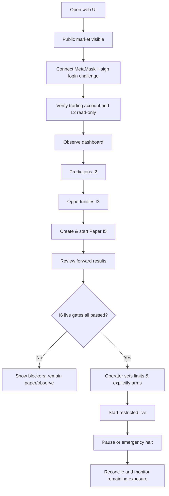

# UX.md — Polymarket Trading Desk (Plain-Language Product and Interaction Design)

> **Version:** 1.0 · 2026-10-16  
> **Audience:** product designers, React developers, operator and anyone unfamiliar with trading infrastructure  
> **System contract:** [Architecture.md](Architecture.md). Each of six iteration plans states when individual screens become functional.  
> **Design rule:** Help a beginner understand **what the app knows, what it recommends, what it has actually done, and what could still go wrong**.

---

## 1. Product concept

**Product name (working):** *Polymarket Trading Desk*. A clean local web application where one owner connects a MetaMask account, watches the current BTC five-minute prediction market, sees understandable probability/edge estimates, and eventually runs **paper** or carefully authorized **live** automated trading. The trading backend operates independently of the browser after an explicitly started run.

**What the application must never pretend:** a wallet is verified when it is only locally connected; a quoted price is an executable price; a prediction equals an actual outcome; a positive theoretical edge is guaranteed profit; a paper trade is a real fill; an official result is an independently verified oracle report; a pause reverses filled exposure.

### 1.1 User stories in normal language

- “Connect with MetaMask and tell me whether you can really see my Polymarket account.”
- “How much cash is actually available to trade? Show my existing holdings and orders.”
- “For this five-minute window, show the two outcomes, prices, countdown and what BTC is doing.”
- “What does the model think? Why is its estimate different from the market price?”
- “Do we see a real opportunity *after fees*, or should the bot do nothing?”
- “Let me try automatic trades with fake money using live prices before I risk my balance.”
- “Show every simulated or real trade, its status and why it happened.”
- “When I eventually enable live trading, let me set a strict maximum loss and stop it instantly.”
- “When something fails, tell me precisely what is unavailable and how to recover safely.”

### 1.2 UX qualities

Clear first, fast second, visually polished third. Use readable labels instead of API jargon; tooltips can disclose technical details. No deceptive green badges, profit celebration animations, false certainty, fabricated demo data on connected screens or automatic high-risk defaults.

## 2. Visual design system

**Style:** professional trading console, calm and approachable; modern dark theme default and supported light theme. Optional configurable accent color, but reserve green for *confirmed* positive/healthy and red for *actual* risk/error; colors always accompanied by a word/icon. Avoid oversized dashboards on mobile.

- **Typography:** clear sans-serif (system/Inter-like), 14–16px normal text, tabular numbers for money and timer. 16px minimum mobile input text. Strong hierarchy: page title, short explanation, key cards, charts, detailed tables.
- **Spacing:** 8px rhythm; desktop content max width around 1440–1600px, comfortable 24px gutters; mobile 16px. Cards 12–16px radius; large click/touch targets at least 44px.
- **Color semantics:** `Connected` neutral/healthy; `Unavailable` gray; `Stale data` amber; `Blocked` red with description; `Paper` blue; `Live` uniquely strong warning tone with persistent explicit label; no relying on red/green alone.
- **Numbers:** prices with `¢` and $ precision as appropriate; display fees and expected value in both per-share and total currency; `UTC` in technical detail, local timezone with explicit label for main UI. Countdown with seconds. Never truncate amounts silently or combine USD and USDT as identical.
- **Charts:** actual spot/market observations in distinct traces; periods without data show a gap, not an interpolated continuous line. Predictions shown with model version and uncertainty; do not draw a confidence band if not calibrated.
- **Accessibility:** keyboard navigation, clear focus, ARIA-live for critical updates, accessible chart tables, no flashing green/red changes, reduce-motion support, screen reader alternatives, error text next to field.
- **Motion:** subtle connectivity/countdown state changes; disable trading actions while requests are in progress, prevent double-click submissions, no automatic modal confirmation dismissal.

## 3. Global application shell

**Desktop layout:** left sidebar, compact top status strip, main content, optional right-hand contextual panel. **Mobile:** collapsed navigation drawer, stacked cards; charts and tables horizontally scroll with fixed identifying columns where possible. Live-trading arming is desktop-only in v1; mobile may view status and trigger authenticated emergency halt if safe to support.

### 3.1 Navigation and delivery matrix

| Navigation | Simple description | I1 state | When fully functional |
|---|---|---|---|
| **Overview** | “What is happening right now?” | Real live market/connection summary | I1, progressively enhanced I2–I6 |
| **Markets** | “Current BTC market and next one” | Live two-sided prices, book, countdown | I1 |
| **My Account** | “My money, shares and existing orders” | Authenticated read-only where verified | I1 |
| **Predictions** | “What our model thinks will happen” | Guided empty state | I2 |
| **Opportunities** | “Possible trades after costs” | Guided empty state | I3 |
| **Trading** | “Control simulated or real automated trading” | Always `Not yet available` | I4 workflow view; I5 Paper; I6 Live |
| **Orders & Trades** | “What happened to every order” | Existing account read-only list if available | I4 ledger view; I5/I6 mode-specific |
| **Portfolio & PnL** | “How much did we really earn or lose?” | Account holdings snapshot, no bot PnL | I4/I5/I6 |
| **Performance** | “Is the bot improving?” | Informative placeholder | I2 scoring, I5 forward financial performance |
| **Settings & Health** | “Account, feeds, limits and problems” | Real integration and feed diagnostics | I1, expanded every iteration |

Sidebar badges show mode and critical incident count. Disabled future screen pages should explain “Coming in Iteration 3” with the planned inputs; never present fake forecasts or orders as real data.

### 3.2 Top status strip (always visible)

Left: application name, BTC 5m market phase. Middle: `Market data: Live / Delayed 3.2s / Recovering / Offline`, `Account: Verified / Not connected / Mapping unknown`. Right: `Mode: Observe | Paper | Live`, operating state, currently active run, mini clock, action to view incidents. In live mode show unmistakable `LIVE — REAL MONEY` persistent text, not just color.

### 3.3 Unified empty/loading/error pattern

Every content area has exactly defined states:

| State | Visible message | Behavior |
|---|---|---|
| Loading | “Checking Polymarket…” | Skeleton, no fabricated last price |
| Empty | “No active BTC 5-minute market found.” | Explain next refresh; do not default to unrelated market |
| Public feed unavailable | “Live prices are temporarily unavailable.” | Age of last update; freeze chart with `Stale` overlay, do not represent as live |
| Account disconnected | “Connect your wallet to view account details.” | Keep public market data visible |
| L2 credentials missing | “CLOB API credentials are not configured on the server.” | No secret fields in browser; link to local setup guide |
| Account identity mismatch | “MetaMask wallet and Polymarket trading account are not yet verified as related.” | Do not show someone else's balance |
| Reference unverified | “Model uses an estimate, not Polymarket's official settlement price.” | Research-only label and reduced capability |
| Paused | “The bot is not opening new trades. Existing positions still need attention.” | Show outstanding orders/positions |
| Unknown order | “Exchange response uncertain. New trades paused until we reconcile.” | Details/status, no Retry Order button |

## 4. First launch and connection wizard (Iteration 1)

A first-time user should finish setup in 3–5 small understandable steps. Each step is independently retryable; public market view should work without credentials.

**Step 1 — Welcome:** “Watch and analyze BTC 5-minute markets. Real-money trading is disabled until you deliberately activate it later.” Display environment: `Local computer`, `Observe mode`, current SDK status and system prerequisites. Button **Continue**.

**Step 2 — Connect MetaMask:** one clear **Connect MetaMask** action; request Polygon-supported account and show network requirement. On connection, explain “This connects your browser wallet; it does not give the app permission to trade.” Next button **Sign in safely** triggers a nonce-based domain-bound login message, displays purpose/expiry and requires explicit MetaMask confirmation. Failures: user rejected, extension missing, wrong chain, expired challenge, unsupported wallet, signature incorrect, address not on operator allowlist. “Try again” starts fresh nonce.

**Step 3 — Verify Polymarket account:** server reports only presence/auth status of the existing `POLYMARKET_API_KEY`, `POLYMARKET_API_PASSPHRASE`, `POLYMARKET_API_SECRET` env vars (never their values). Run a bounded read-only CLOB probe, resolve actual signer/trading-wallet mapping and show separately: `Browser signer`, `Trading wallet`, `Account verified`, `Read-only API`. If mapping is unclear, clearly display blocker and allow using public Markets without falsely granting account access. No instruction to paste secret into the browser.

**Step 4 — Market data:** show currently discovered BTC 5m market, its precise time window, Up and Down token mapping, Polymarket depth health, BTC public feeds, and whether reference price is `Verified / Estimate / Unavailable`. If a provider is unavailable, show self-contained diagnostics and permit continue in limited Observe mode.

**Step 5 — Ready:** “You can watch markets. Predictions, opportunities and automated trades will be available in later iterations.” CTA **Open Dashboard**; advanced details expandable. Wallet logout invalidates session; does not silently disconnect or liquidate positions (paper/live run lifecycle is separate).

## 5. Screen: Overview

### 5.1 Wireframe, desktop

```text
┌──────────────────────────────────────────────────────────────────────────────────┐
│ Trading Desk    BTC 5m · Live feed 0.4s old     OBSERVE     Account: Verified   │
├──────────────┬───────────────────────────────────────────────────────────────────┤
│ Overview     │ BTC Up/Down · Current window                     Ends in 02:14    │
│ Markets      │ ┌───────────┐ ┌───────────┐ ┌───────────┐ ┌───────────────────┐│
│ My Account   │ │ BTC spot  │ │ Up ask    │ │ Down ask  │ │ Spendable balance ││
│ Predictions  │ │ $...      │ │ ..¢       │ │ ..¢       │ │ $... or Unknown   ││
│ Opportunities│ └───────────┘ └───────────┘ └───────────┘ └───────────────────┘│
│ Trading      │                                                               │
│ Orders       │  ┌──────────────────── BTC price and threshold ────────────────┐ │
│ Portfolio    │  │   Chart with genuine gaps and last-update time            │ │
│ Performance  │  └────────────────────────────────────────────────────────────┘ │
│ Settings     │                                                               │
│              │  Model: not built / pUp with basis      Best opportunity: —    │
│              │  Open positions: N    Paper status: Not configured            │
│              │  Feed warnings / current incidents / active run              │
└──────────────┴───────────────────────────────────────────────────────────────────┘
```

Prioritize **current market, account state, mode and safety**. Do not give a hypothetical “Profit today +$42” card before any bot trades exist. In later iterations add “Estimated Up 57% (Research-only)” and “No tradable opportunity” cards; update in real time but rate-limit visual redraw to avoid flashing.

## 6. Screen: Markets (functional I1)

- Header: `BTC Up or Down — [local start] to [local end]`, 5-minute countdown, `Trading open / Closing / Closed / Settling / Resolved`, market ID, source link.
- Current and Next tabs; choose closed market for historical inspection only, never send an order for closed market.
- Main chart: public BTC price series, reference proxy marker when available, opening value only when identified with source. Highlight uncertainty near threshold; missing data shown as discontinuities.
- Two outcome cards: **UP** and **DOWN**, each with **Buy price (best ask)**, **Sell price (best bid)**, spread, available top-level quantity, order-book freshness and deeper levels. Use `¢` and underlying token ID in collapsible details.
- Two-sided depth panel: bid/ask price/size and cumulative size; separate Up/Down tabs. Timestamp and validity always visible. Empty real book differs from stale/unavailable book.
- Market details accordion: exact market rule text and provider link, resolution source, contract opening/closing timestamps, outcome token mappings, fee schedule, tick/min sizes, API source, last receive time.
- Near close: countdown amber plus message “Low time remaining; possible late fills or settlement risk.” Display `No new trading` where backend market/risk forbids it.

**Layman tooltip:** “An Up contract costing 48¢ pays $1 if Up wins; it may be worth $0 otherwise. The price may change before the market closes. The number on the screen may not be the price you get for a large order.”

## 7. Screen: My Account (functional I1)

Top cards: connected signer address (abbreviated, expandable), confirmed trading account address, **spendable trading collateral**, held Up/Down positions, open exchange orders, last successful reconciliation. If only public wallet address is known, show `Not verified` instead of a balance. Distinguish pUSD trading collateral from other wallet assets; no combined ambiguous “Wallet Balance”.

Sections: `Holdings` table (market, Up/Down, shares, cost basis if known, estimated current bid value, settled state), `Open orders` table (order reference, side, price, filled/remaining, state), `Recent exchange activity`. Historical bot strategy attribution starts I4; never attribute existing manual account trades to the bot. Account actions in I1 are read-only. Explain why a balance/position may differ from MetaMask due to smart-wallet account architecture.

## 8. Screen: Predictions (I2)

**Headline language:** “Our estimate of the Up outcome, not a guarantee.”

- Large twin percentages (sum to 100%), single model age clock, latest usable source status.
- Side-by-side **Our estimate** vs **Market prices** with explanation that market bid and ask differ; do not treat midpoint as an executable price.
- Probability-over-time chart, optional observed market baseline, reference uncertainty label and official-outcome marker after resolution.
- Explainability card: “Bitcoin is currently above/below the estimated starting reference; approximately XX seconds remain; short-term volatility is …; some reference data is unverified.” Only show actual computed contributing factors.
- Confidence label vocabulary: `Validated band`, `Provisional estimate`, `Not calibrated`, `Prediction unavailable`. If probability bounds unavailable, do not draw a shaded statistical interval.
- Historical **forward observations** table (market, when prediction made, Up probability, final official outcome, model version, rule/reference basis), scoring panel Brier/log loss and calibration when enough valid labeled samples exist.

No flashy “95% WIN SIGNAL” and no unexplained AI confidence scores.

## 9. Screen: Opportunities (I3)

Each opportunity card explains the action in plain terms:

```text
Possible trade: Buy UP          Status: RESEARCH ONLY
Estimated Up chance:    57%
Current ask:            48¢
Expected average fill:  49¢ for 25 shares
Estimated fees:          1.7¢ per share (scenario / current fee schedule)
Conservative net edge:  UNAVAILABLE (model not yet calibrated)
Execution:              25 shares at inspected book levels, before latency
Reason:                 Pricing may be below estimated value
Blockers:               Unverified oracle proxy; bounds unavailable
Decision:               NO TRADE
```

Use actual data for each field; example numbers above are illustrative and **must not appear as live data**. Show competing opportunities (Up, Down, Pair, Maker) and explain rejected alternatives: insufficient depth, aged book, uncertain probability, opposing inventory, too close to expiry, order size minimum, fees eliminate edge, loss cap. Show threshold and approximate max feasible quantity graph. If none, `The bot is watching; it has not found a credible after-cost advantage.` Do not add manual “Execute now” in I3.

## 10. Screen: Trading and run control (I4–I6)

### 10.1 Modes

Three mutually exclusive views:

- **Observe:** watching without trades; default I1–I4.
- **Paper trading:** simulated orders using current live markets and a virtual balance; enabled only in I5. Blue persistent `PAPER / SIMULATED` label.
- **Live trading:** real account balance and signed exchange orders; enabled only in I6 after all authorization gates. Persistent `LIVE / REAL MONEY` header, preflight and halt control.

Paper and live must use **separate tab labels, database mode keys, run IDs, order badges, cash cards and PnL summaries**. Do not merge paper realized PnL into actual earnings. Switching display tabs does not affect backend mode. An intentional backend mode transition triggers a server-owned state machine, not simple frontend state.

### 10.2 Paper start wizard (I5)

1. Choose `New paper account` or existing stopped run; enter simulated initial bankroll and optional notes. Reset creates a **new** account/run; does not delete prior performance.
2. Set conservative paper limits and available strategies (directional first, pair and maker only after their critical behavior is tested).
3. Review live feed status, current market, model reference quality, validated cost model, and predicted order simulator quality.
4. Confirm **Start Paper Trading**. Show `Running since ...`; server continues while browser closed. Buttons `Pause new trades`, `Stop`, `View orders`, `Reset with a new paper account` only after run stops.
5. If feed invalid, display `Paper paused — waiting for trustworthy order book`; never let a silent gap create fictitious fills.

### 10.3 Live activation ceremony (I6)

Live is **not** a flip-switch or a normal settings checkbox:

1. Operator selects `Live Trading`, reads all independent gate statuses, including signer/account binding, current geolocation/eligibility and official settlement limitations. Any blocking item disables `Arm`.
2. Operator enters **real numerical limits** (max capital committed, max loss/trade, daily loss, concurrent exposure, unmatched pair cap/duration, cutoff before close); server rejects zeros/inconsistent values and records policy version. Initial default is no live spending.
3. Show `Available exchange balance`, `Maximum possible loss under allowed orders`, `Existing open positions`, `Orders that might still fill`, and signer scope/expiration. Calculate from reconciled account state, never from cached webpage number.
4. Read confirmation: “I understand this places real-money orders automatically, even when this browser is closed, until stopped or halted.” Typed phrase and fresh MetaMask operator signature required for arming; short expiry; audited.
5. Second explicit **Start Live Trading** control becomes available only after successful arm and final backend gate check. No auto-start after restart.
6. `Pause new orders` and **Emergency HALT** always visible. Emergency halt asks for no modal and immediately sends authorized fail-closed halt action; show “New orders stopped. Existing orders/positions may remain; reconciliation/cancellations in progress.” Actual confirmation status must come from server; do not claim halted until acknowledged.

Mobile emergency halt may require short-lived authenticated session; never hide behind menu in live mode. No force-enable if geo/signer or source verification fails.

## 11. Screen: Orders, positions, performance and ledger

**Orders & Trades** filter by `Mode`, `Run`, `Market`, `Strategy`, `State`, `Time`. Each row shows timestamp, Up/Down, buy/sell, requested quantity, filled quantity, average actual/simulated fill, fees, origin proposal and latest order state. Order detail timeline: `Prediction -> Opportunity -> Risk approval -> Submission -> Partial fill(s) -> Cancel/Settle -> Ledger` with source snapshots and any uncertainties. Tooltips explain **partially filled**, **pending cancel**, **submission unknown**, **settlement pending**.

**Portfolio:** account cash/collateral, reserved cash, open Up and Down holdings, paired and unpaired quantities, realized vs unrealized PnL, estimated exit value and fee adjustment. Clear note: mark-to-bid unrealized is only an estimate. A pair is fully hedged **only after both sides are filled**; show “Unmatched shares at risk” prominently.

**Performance:** `Net PnL after costs`, `Paper vs live`, `Win/loss`, `Maximum drawdown`, `Fees`, `Fill rate`, `Missed/partial trades`, `Prediction calibration`, `P&L by strategy`, `Exposure by market`, with time period controls and an export including mode/run, model/fee version and assumptions. Include source/outcome coverage and uncertainty. No annualized ROI claim from a few 5-minute markets. If there are no legitimate realized results show `No settled results yet`.

## 12. Screen: Settings & Health

Grouped panels (no technical overkill on first view):

- **Account & Security:** MetaMask signer, trading wallet, L2 credential configured/authenticated (masked status only), signer capability (`Not configured` until I6), session logout and allowed operator identity.
- **Feeds:** Polymarket books Up/Down, BTC venue 1/2, market catalog, optional reference source, SQL connectivity, last good observation, reconnect/gap counters and actionable diagnostics.
- **Trading rules:** paper/live separated, max per-trade spend, daily stop, total exposure, mismatch budget, time-to-close cutoff; live defaults immutable zero until approved.
- **Model:** active model version, reference basis, calibration status and sample count; technical diagnostics expandable.
- **Ledger & Data:** last reconcile, retained reports, data disk capacity, backup/restore status, export CSV/JSON.
- **Incidents:** list with exact severity, start/recovery, affected mode, safe auto-actions, next step and audit. Never show raw secrets or stack traces in browser.

### 12.1 Alert hierarchy

1. **Critical**: live signer/identity mismatch, unknown order state, unreconciled funds, location blocked, loss stop, DB corruption. Persistent banner; trading halted/no-new-risk, meaningful instructions.
2. **Warning**: delayed order book, estimated reference, short feed gap, uncalibrated model. Trading proposals suppressed as appropriate.
3. **Info**: paper start/stop, market rollover, completed settlement, model version change.

Send toasts for non-critical changes; persistent actionable panel for critical events. A disconnected browser does not replace backend protection.

## 13. Navigation flows and state transitions



**Critical behavior scenarios:** A browser reload must restore exact server run state; login expiration must not make the backend ignore an outstanding live position; switching to the next 5-minute market must not delete previous window's open exposure; an upstream outage must freeze a displayed last value and show `Stale`; unexpected PnL changes need a ledger audit path. At no time should UI controls claim remote order cancellation was confirmed when it is still uncertain.

## 14. Copywriting reference

| Avoid | Use |
|---|---|
| “AI says BUY now!” | “Estimated positive edge, pending risk checks” |
| “You will earn $7.20” | “Estimated expected value: +$7.20 under the shown assumptions” |
| “Balance: $500” when unknown | “Available trading balance unavailable — account not verified” |
| “Arbitrage guaranteed!” after one leg | “First leg filled; opposite leg still at risk” |
| “Bot stopped, safe” | “New orders stopped. Review remaining open orders and positions.” |
| “95% accurate” without labels | “Prediction accuracy: insufficient resolved observations” |
| “No fee” based on a guess | “Fee metadata unavailable; opportunity not tradable” |
| “Oracle price” for an exchange estimate | “Estimated reference (not official settlement reading)” |

**Definitions surfaced by hover/help:** Up contract, Down contract, best ask, best bid, spread, fee, quantity, probability, expected value, realized PnL, unrealized PnL, paper trade, liquidity, partially filled, stop-new-orders and settlement.

## 15. UX acceptance and usability checks

- **I1:** new user can navigate and inspect current/next real market, connect MetaMask, understand which wallet is controlling vs holding funds and see why balance may be unavailable; credentials never browser-visible; refresh/reconnect preserves current view.
- **I2:** user understands difference between model probability and market ask, recognizes `Not calibrated` and can inspect source and model age.
- **I3:** each opportunity shows size, all-in cost, basis for edge and a plain reason for rejecting a trade; no misleading green ROI.
- **I4:** order timeline accurately represents unknown and partial states, mode attribution and corrected ledger activity.
- **I5:** user can start/pause/stop paper trading from UI, tell that it uses fake money, see after-cost PnL and that browser closing does not change run state.
- **I6:** cannot start real orders by accident; live controls require explicit verified credentials and limits; emergency action stops new risk and reports unresolved exposure truthfully.
- Responsive at 360px phone, tablet and 1440px desktop; keyboard and screen-reader smoke; authenticated APIs protected from cross-site requests; no dead-end errors or 404s from sidebar.

## 16. UX deliverable checklist for developers

For **every iteration**, implement real backend/API data and real error/empty states before visual polish sign-off. Each new status label maps to a documented server state. Use generated TypeScript API types, one shared design system and systematic decimal/timezone formatting. Include screenshots of normal, disconnected, stale and blocked views as evidence; screenshots must not expose addresses beyond necessary redacted portions or any secrets. Read this file together with the appropriate `Iteration-N-Implementation-Plan.md` rather than inventing demo screens in isolation.